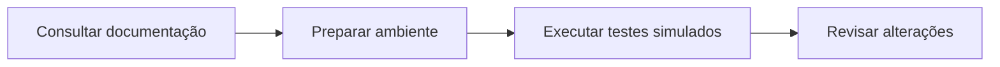

<div align="center">

<h1>🌐 Portal Gaia</h1>
<p><strong>Organiza&#231;&#227;o da equipe: membros, tarefas, presen&#231;a, avisos e calend&#225;rio.</strong></p>
<p><kbd>HTML &#183; JavaScript &#183; Firebase &#183; EmailJS</kbd></p>

<p><a href="https://github.com/Pedronsjaja/portal-gaia/stargazers"></a> <a href="https://github.com/Pedronsjaja/portal-gaia/commits/main"></a></p>
<p><a href="#inicio-rapido">Comece aqui</a> · <a href="#guia-do-projeto">Documentação</a> · <a href="https://github.com/Pedronsjaja/portal-gaia/tree/main">Arquivos</a></p>

</div>

<a id="inicio-rapido"></a>
## 🚀 Comece aqui

**[Consultar alterações e limitações](ALTERACOES.md)**

> Esta é uma cópia de desenvolvimento com histórico. Créditos, autoria e instruções do projeto original estão preservados na documentação abaixo.

| Gestão | Comunicação | Manutenção |
| --- | --- | --- |
| Membros, tarefas, horas e calendário da equipe. | Avisos e notificações integrados aos serviços do projeto. | Histórico e testes de e-mail e interface preservados. |

### Caminho do projeto



<a id="guia-do-projeto"></a>
## 📖 Documentação

Portal da equipe GAIA para gestão de membros, tarefas, presença, horas, avisos e calendário, integrado ao Firebase e ao EmailJS.

Este repositório é uma cópia com histórico do [projeto original da GaiaRobotca](https://github.com/GaiaRobotca/portal-gaia), mantida na conta de [Pedro Henrique — @Pedronsjaja](https://github.com/Pedronsjaja).

## Colaboração e manutenção

**Pedro Henrique Barbosa de Freitas Soares (@Pedronsjaja)** — manutenção desta cópia, melhorias de cadastro e notificações por e-mail.

Os autores e colaboradores anteriores permanecem registrados no histórico Git. A identificação neste README não concede permissões no repositório original; os acessos são administrados separadamente no GitHub.

## Executar

Sirva esta pasta com um servidor estático e abra `index.html`. Mantenha `email-queue.js` junto ao HTML. Não há etapa de compilação.

O portal usa a configuração Firebase já presente no projeto e compartilha a mesma base da equipe; rodar esta cópia não cria uma base de testes. Os testes abaixo simulam os serviços externos e não alteram essa base.

## Testes

Com Node.js instalado:

```sh
node --test tests/email.test.cjs
```

Para o teste de interface, instale Playwright e tenha Microsoft Edge disponível:

```sh
npm install --no-save --package-lock=false playwright
node tests/browser.cjs
```

## Publicação e e-mails

Publique `index.html`, `email-queue.js` e `og-image.png` na mesma pasta. Enviar os arquivos ao GitHub não atualiza automaticamente o site da GaiaRobotca. Esta cópia não habilita GitHub Pages automaticamente.

Configure o destinatário do template EmailJS como `{{to_email}}`, o assunto como `{{notice_title}}` e o corpo com `{{to_name}}` e `{{notice_body}}`. Cadastre os endereços dos membros pendentes em **Config. E-mail**.

Consulte [ALTERACOES.md](ALTERACOES.md) para os resultados dos testes e as limitações dos lembretes.


## Validacao de engenharia

[Checks offline e limites do backend](docs/engineering-status.md).
